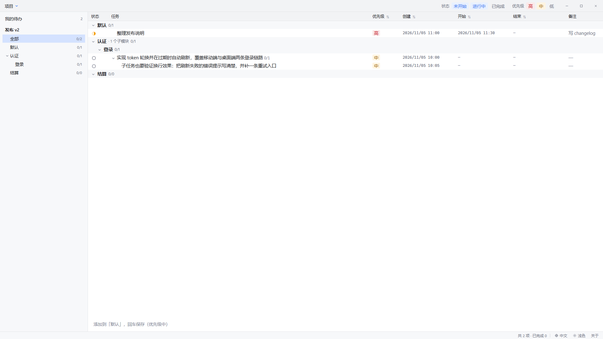
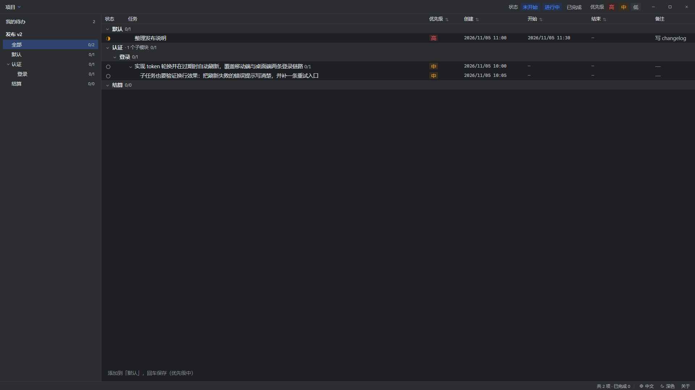

# Knot

Knot（结）——一道结记一件事。开发任务的结构化清单：单人、本机、不联网的桌面待办。
需求见 [docs/specs/goal-and-requirements.md](docs/specs/goal-and-requirements.md)，分层与数据模型见 [docs/specs/architecture.md](docs/specs/architecture.md)，
**剩下要做什么见 [docs/ROADMAP.md](docs/ROADMAP.md)**。English: [README.en.md](README.en.md)。

## 截图

中文 · 浅色：



中文 · 深色：



## 当前状态

完整功能已就位：
- 项目 / 模块 / 子模块三级结构（新建、原地改名、拖动排序、两段式删除）
- 任务与一层子任务
- 父子状态联动
- 状态/优先级筛选、排序
- 备注、创建/开始/结束时间自动记录
- 跨项目移动与父子互转
- 迁移前自动备份与启动错误页

已实现 23 条发布命令 + 1 条仅开发版命令（`reset_database`），完整清单见
[docs/ROADMAP.md](docs/ROADMAP.md#现状)，不在本文重复维护。

界面支持**中文 / English / 跟随系统**三态切换（状态栏语言按钮，选择记在本机）；后端错误、确认理由与联动提示
也走同一套结构化消息翻译。英文术语表见 [docs/i18n/glossary.md](docs/i18n/glossary.md)。

## 结构

```
index.html            窗口骨架：左栏 + 主区；静态文案只留 data-i18n 占位
src/
  api.ts              唯一的前端 ↔ 后端接口层（invoke 只出现在这里）
  errors.ts           把结构化后端消息 / 字符串 / Error 变成一句本地化提示
  grouping.ts         纯函数数据管线：组内排序、按模块建树分组、范围筛选、分组计数
  grouping.test.ts    纯函数单测（vitest）
  menu.ts             通用弹出菜单组件（弹出/定位/关闭）
  tooltip.ts          自定义悬停提示
  main.ts             状态 + 事件 + 渲染（原生 DOM，无 UI 框架）
  i18n/               语言状态、中英字典、静态文案绑定、日期格式化、后端消息翻译
src-tauri/src/
  main.rs             入口，只调 knot_lib::run()
  lib.rs              装配：建连接、托管状态、注册命令、启动错误窗口
  commands.rs         命令层：参数解包 + 转发，不含规则
  domain.rs           领域层：唯一写入口，所有规则住在这里（含单测）
  message.rs          结构化消息 { key, params } 与 catalog
  db.rs / migrations.rs  存储层：库文件、连接、备份、schema 迁移
src-tauri/backend-keys.json   前后端共享的后端消息 key 契约
```

## 开发

```bash
npm install
npm run tauri dev      # 开发窗口（前端热更新）
npm test               # 前端纯函数单测（vitest）
npm run build          # 前端类型检查 + 打包
cargo test --manifest-path src-tauri/Cargo.toml   # 后端规则单测
npm run tauri build    # 出安装包（需系统已有 WiX/NSIS）
npx tauri build --no-bundle    # 只出 release exe，不打包安装包、不下载 WiX/NSIS
```

数据库文件：Windows `%APPDATA%/knot/tasks.sqlite`（macOS/Linux 为对应平台的 app data 目录）。
删掉该文件即可重置。

## 分层规矩

- 规则只在 `domain.rs` 里表达，不用 SQL 触发器重复一遍。
- 前端不重算聚合规则，写操作之后一律全量重取当前容器。
- `invoke` 只出现在 `src/api.ts`。
- 用户可见文案只在 `src/i18n/**` 与后端 `message.rs` 的 key 里；新增后端 key 必须同步
  `src-tauri/backend-keys.json` 和中英两张翻译表。
